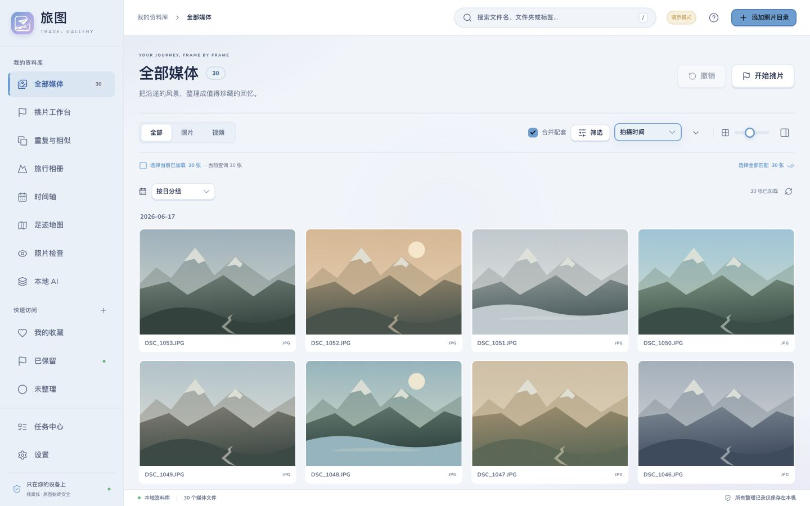

<div align="center">

[简体中文](README.md) · **English**

<a href="https://merlinalex1028.github.io/travel-gallery/en/"></a>

# Travel Gallery · 旅图

### Keep the moments that move you.

**Your photos stay on your drives. Your memories find their place.**<br>
Browse, cull and find duplicates on your own computer.<br>
Turn scattered photos and videos into journeys worth revisiting.

[](https://github.com/merlinalex1028/travel-gallery/releases)


**[Download](https://merlinalex1028.github.io/travel-gallery/en/#download)** · **[Website](https://merlinalex1028.github.io/travel-gallery/en/)** · **[User guide](https://merlinalex1028.github.io/travel-gallery/en/guide.html)** · **[Releases](https://github.com/merlinalex1028/travel-gallery/releases)** · **[Issues](https://github.com/merlinalex1028/travel-gallery/issues)**

<br>



<sub>Actual app interface · Built-in demo media, not personal photos</sub>

</div>

## Is Travel Gallery for you?

After a trip, your camera, phone and drives hold countless little moments. Folders store files, but finding that favorite frame from the evening can take more work.

Travel Gallery brings them into a local catalog:

- **Photos and videos together**: reference existing folders, build indexes and thumbnails, and combine capture time, format, tags and ratings to filter your library.
- **Cull with a few keys**: keep, maybe, reject, rate and favorite, with multi-photo comparison and undo.
- **Find duplicates and similar scenes**: separate exact duplicates, visually similar candidates and time-based bursts, then decide what to keep yourself.
- **Bring a journey together**: trip albums, timelines, an offline photo map and travel stories connect photos with time and place.
- **Keep records on your device**: no cloud account; original photos and videos remain in their source folders.

It is for organizing travel media on local drives, making your own choices and continuing offline. Cloud sync, online collaboration and professional photo editing are outside the current scope.

## Languages and user guide

Use **EN / 中文** in the website header to switch between localized home and guide pages. Installation and everyday instructions are available within the website. Source code, GitHub feedback and release attachments have explicit GitHub links.

In the app, use the toolbar or **Settings → Interface language** to switch between 中文 and English immediately. The choice is saved on this device. Menus, pages, dialogs, dates and component labels follow the language. Your own tags, notes, trip names and filenames stay unchanged. Language resources are bundled locally; no online translation is used. Native tool diagnostics, system permission dialogs and release notes may retain their original language.

**[English guide](https://merlinalex1028.github.io/travel-gallery/en/guide.html)** · **[中文使用指南](https://merlinalex1028.github.io/travel-gallery/guide.html)**

## Quick start

**1 · Install.** Download the installer for your platform from the [website](https://merlinalex1028.github.io/travel-gallery/en/#download) or [GitHub Releases](https://github.com/merlinalex1028/travel-gallery/releases).

| Platform            | Installer                                            | Requirements                                         |
| :------------------ | :--------------------------------------------------- | :--------------------------------------------------- |
| macOS Apple Silicon | Open the `.dmg`, then drag the app into Applications | macOS 13 or later; Apple Silicon                     |
| Windows x64         | Run `setup.exe` and follow the installer             | Windows 10 / 11; offline WebView2 installer included |

Stable and prerelease builds are identified by the download entry. Read [Installation and first launch](#installation-and-first-launch) before installing.

**2 · Add a photo folder.** Click **Add photo folder** and select a folder on your computer or external drive. Travel Gallery indexes it and generates thumbnails in the background. Originals stay in place.

**3 · Start organizing.** Browse the library or flag favorites in the **Culling desk**. Create trip albums. Preview before making copy exports to share.

## Features

| Feature                       | What you can do                                                                                                        |
| :---------------------------- | :--------------------------------------------------------------------------------------------------------------------- |
| **Library and filters**       | Browse photos and videos; filter by filename, folder, time, format, tags and ratings; save smart filters               |
| **Focused culling**           | Keep / Maybe / Reject, star ratings, favorites, notes, multi-photo comparison and undo                                 |
| **Duplicates and similarity** | Use file-byte SHA-256 for exact duplicates, with separate visual-similarity and burst groups for manual review         |
| **Trips and places**          | Create albums, explore timelines and offline maps, and organize travel stories                                         |
| **Copy export**               | Preview file counts, space, collisions and missing sources; optionally include ratings, tags and notes as XMP          |
| **Local analysis**            | Optional local AI and eye/detail hints; off by default, with separately imported offline models                        |
| **Catalog maintenance**       | Manage sources and missing files; back up and restore the local catalog                                                |
| **In-app updates**            | Choose automatic or manual stable-release checks in Settings; download, verify, install and restart after confirmation |
| **Light and dark**            | A shared blue, lavender and pink palette with a dark theme                                                             |

### Checking and installing updates

Open **Settings → App updates → Check for updates**. When a newer version is available, choose **Download update** to see progress. After signature verification, choose **Install and restart** and confirm. The local catalog, organization records and originals are preserved. Save edits and finish or cancel every background task, including paused ones, first. Retry installation failures or download a new installer to install manually.

**Automatic update checks are off by default**, and the switch saves immediately. Enabling it checks at startup and every 4 hours, only notifying you. Downloads, installation and restarts require your action. Requests connect to GitHub and its asset services without sending photos, file paths or catalog contents. Offline use does not affect core browsing and organization. Downloads remain in the current process only; quitting requires downloading again.

In-app updates support **macOS Apple Silicon / Windows x64 release builds** and follow GitHub's latest stable release. Get prereleases from the website. Missing manifests or unavailable networks show a check failure. Browser demos, development and audit builds do not check for or install updates. On macOS move the app into Applications and launch it from there. Update signing verifies integrity and origin; it does not replace Apple notarization or Windows publisher signing, and the system may still request installation permission.

If an older app has no update setting, install a release containing this feature manually first. Publishers must configure the free update-signing key and publish update assets as described in the [release guide](docs/RELEASING.md).

### Live Photo pairing and preview

For unmodified originals exported by Apple Photos, Travel Gallery reads Apple content identifiers in JPG / JPEG / HEIC / HEIF and MOV files. Unique matches pair automatically. **Merge companions** is on by default and displays confirmed pairs as one card labeled `LIVE · 2`. Matching names in the same folder without valid identifiers are candidates and need confirmation in **Photo details → Companion media → Confirm pairing**.

The viewer has a small `LIVE` badge at the top left. Hover over it to play the confirmed MOV silently once in the same frame. Leaving stops playback and restores the photo. The clip does not loop while you hover; leave and re-enter to replay. Focus the badge and press Enter / Space, or tap on a touch screen, to play or stop. Changing photos or closing the viewer stops playback. Candidates do not play or confirm automatically; reviews still apply to the current photo. Playback depends on local decoding. Retry or open the companion MOV in the system app if needed. This previews the companion video without Apple's native press-and-transition effects.

Apple-exported XMP is an optional IPTC sidecar; it is not used for pairing and its contents are not currently imported. Exports can include confirmed companion originals; **Include XMP** separately generates Travel Gallery's tags, ratings and notes. Photos and videos stay separate and are never re-encoded into one file.

### Keep your hands on the keyboard

| Key             | Action                    |
| :-------------- | :------------------------ |
| `P` / `X` / `U` | Keep / Reject / Maybe     |
| `0`–`5`         | Star rating               |
| `F`             | Toggle favorite           |
| `←` / `→`       | Previous / Next photo     |
| `Space`         | Fit / Original scale      |
| `Tab`           | Toggle details            |
| `⌘/Ctrl + Z`    | Undo organization changes |

## Privacy and originals

**Core browsing and organization run locally.** Indexes, ratings, tags and albums live in local SQLite. No cloud account or photo uploads. The photo map uses a bundled Natural Earth overview without online map requests.

**Adding a source creates an index and keeps originals in place.** Duplicate checks and analysis provide hints; they do not delete originals or automatically reject photos based on AI. Copy exports are previewed and confirmed by you.

When exporting photos, videos and XMP, relative preview paths consistently use `/`. Files are written to temporary copies and verified before publication. Destination collisions preserve existing content. Directories are protected against substitution; failure cleanup removes only temporary files created by this operation whose identity still matches.

**A catalog backup is not a photo backup.** It excludes originals and separate model packages. Back those up separately.

Local AI, closed-eye and detail hints are off by default. Import separate offline models manually; models are not downloaded automatically. Website interactions use demo media and do not read your photos. The independent GitHub Pages website needs a connection and has no analytics scripts or third-party font services.

Updates are optional and automatic checks are off by default. Manual checks or enabling automatic checks request a GitHub manifest. Installer downloads only start after confirmation. Local media and records are never uploaded.

## Installation and first launch

Public builds currently require no signing credentials: **macOS uses ad-hoc integrity signing without Apple notarization; Windows is not Authenticode-signed.** This is not a system-trusted publisher signature, so initial launch may show security prompts.

1. Confirm the installer came from this repository's **GitHub Releases**.
2. Verify its hash against `SHA256SUMS.txt`.
3. If macOS blocks opening, look in **System Settings → Privacy & Security → Open Anyway**.
4. If Windows shows SmartScreen, look for **More info → Run anyway**.

Organization-managed devices may not permit manual approval. Do not disable global system security. The release notes state each release's actual signing status.

macOS verification:

```sh
shasum -a 256 Travel-Gallery-*-macOS-arm64.dmg
```

Windows PowerShell verification:

```powershell
Get-FileHash .\Travel-Gallery-*-Windows-x64-setup.exe -Algorithm SHA256
```

## Development and builds

Requires **Node.js 22, pnpm 10, Rust stable** and [Tauri 2 platform prerequisites](https://v2.tauri.app/start/prerequisites/).

```sh
pnpm install --frozen-lockfile
pnpm dev       # Browser demo with mock data only
pnpm desktop   # Isolated native development identifier and data
```

```sh
pnpm test
pnpm build
pnpm test:rust
pnpm site:build
```

The frontend uses Vue 3, TypeScript, Pinia and Element Plus; the native app uses Rust, Tauri 2 and SQLite. Native development uses `com.travelgallery.development`; production uses `com.travelgallery.desktop`. Development and audits use isolated catalogs and owned temporary media, preserving production data and originals.

| Document                               | Contents                                                              |
| :------------------------------------- | :-------------------------------------------------------------------- |
| [Contributor rules](AGENTS.md)         | Isolation, verification, commits, README and website maintenance      |
| [Build and release](docs/RELEASING.md) | Tag-triggered packages, signing, GitHub Pages and retries             |
| [Media tools](docs/MEDIA-TOOLS.md)     | Media dependencies, sources and build instructions                    |
| [Website source](site/)                | Independent static pages; `pnpm site:build` outputs `dist/site`       |
| [Third-party licenses](third-party/)   | Dependency list and license texts, also available offline in Settings |

Contributor reference documents linked above are currently in Chinese. Both README versions and the website's user guides are available in Chinese and English.

## Feedback

[Open an issue](https://github.com/merlinalex1028/travel-gallery/issues) with your platform, app version and reproduction steps. Before sharing screenshots or logs, check for personal photos, file paths and other private information.

If Travel Gallery helps you rediscover a favorite photo, a Star can help others find it too.
