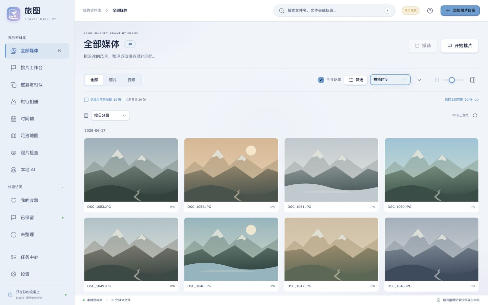

<div align="center">

<a href="https://merlinalex1028.github.io/travel-gallery/"></a>

# 旅图 · Travel Gallery

### 把旅途的心动，好好收藏。

**照片留在你的硬盘，回忆有自己的秩序。**<br>
在自己的电脑上浏览、挑片、查重，<br>
把散落的照片和视频，整理成值得珍藏的旅行。

[](https://github.com/merlinalex1028/travel-gallery/releases)


**[下载旅图](https://merlinalex1028.github.io/travel-gallery/#download)** &nbsp;·&nbsp; **[项目官网](https://merlinalex1028.github.io/travel-gallery/)** &nbsp;·&nbsp; **[快速开始](#快速开始)** &nbsp;·&nbsp; **[版本记录](https://github.com/merlinalex1028/travel-gallery/releases)** &nbsp;·&nbsp; **[问题反馈](https://github.com/merlinalex1028/travel-gallery/issues)**

<br>



<sub>应用界面 · 内置演示素材，非用户照片</sub>

</div>

<br>

## 旅图适合你吗？

一趟旅行回来，相机、手机和硬盘里留下了许多片段。文件夹能收好文件，却很难帮你找到“那天傍晚最喜欢的那一张”。

旅图把这些片段整理进一个本地资料库：

- **一处浏览照片和视频**：引用已有目录，建立索引与缩略图；按拍摄时间、格式、标签、评分等组合筛选。
- **用几个按键完成挑片**：保留、待定、淘汰、评分和收藏，配合多图对比与撤销，让选择更从容。
- **找出重复与相似**：分别查看精确重复、视觉相似和连拍分组，再由你决定留下什么。
- **把片段串成旅行**：相册、时间轴、离线足迹地图与旅行故事，让照片重新有了时间和地点。
- **整理记录留在本机**：无需云端账号，原始照片与视频保留在原处。

如果你想整理本地硬盘上的旅行影像，喜欢自己挑选，也希望不联网就能继续工作，旅图适合你。云端同步、在线协作和专业修图不属于当前功能。

## 快速开始

**1 · 安装应用。** 从 **[官网](https://merlinalex1028.github.io/travel-gallery/#download)** 或 **[GitHub Releases](https://github.com/merlinalex1028/travel-gallery/releases)** 下载对应平台的安装包。

| 平台                | 安装包                       | 系统要求                                  |
| :------------------ | :--------------------------- | :---------------------------------------- |
| macOS Apple Silicon | `.dmg`，打开后拖入“应用程序” | macOS 13 或更新版本；Apple 芯片           |
| Windows x64         | `setup.exe`，按向导安装      | Windows 10 / 11；包含离线 WebView2 安装器 |

当前公开版本为 rc 预发布体验包。首次安装前请阅读下方的[安装与首次启动](#安装与首次启动)。

**2 · 添加照片目录。** 打开应用，点击 **添加照片目录**，选择电脑或外接硬盘上的文件夹。旅图在后台建立索引和缩略图，原文件留在原处。

**3 · 开始整理。** 浏览图库，或进入 **挑片工作台** 标记喜欢的照片。创建旅行相册；需要分享时，先查看导出预演，再复制导出。

## 功能

| 功能               | 你可以做什么                                                                     |
| :----------------- | :------------------------------------------------------------------------------- |
| **图库与组合筛选** | 浏览照片与视频，按文件名、文件夹、时间、格式、标签和评分等缩小范围，保存智能筛选 |
| **专注挑片**       | 保留 / 待定 / 淘汰、星级评分、收藏、备注，多图对比，以及撤销整理修改             |
| **重复与相似**     | 使用文件字节 SHA-256 检查精确重复，另行查看视觉相似与连拍组，逐组人工复核        |
| **旅行与足迹**     | 创建旅行相册、查看时间轴与离线地图，整理旅行故事                                 |
| **复制导出**       | 预演文件数量、空间、冲突与来源缺失；按需附带评分、标签和备注 XMP                 |
| **本地辅助分析**   | 可选的本地 AI 与闭眼 / 细节提示；默认关闭，需自行导入独立模型包                  |
| **资料库维护**     | 管理来源与缺失文件，备份和恢复本地资料库                                         |
| **浅色与深色**     | 统一的浅蓝、薰衣草与樱粉色彩，支持深色主题                                       |

### 把手留在键盘上

| 按键            | 操作                |
| :-------------- | :------------------ |
| `P` / `X` / `U` | 保留 / 淘汰 / 待定  |
| `0`–`5`         | 设置星级            |
| `F`             | 切换收藏            |
| `←` / `→`       | 上一张 / 下一张     |
| `Space`         | 适应画面 / 原始比例 |
| `Tab`           | 显示或隐藏详情      |
| `⌘/Ctrl + Z`    | 撤销整理修改        |

## 隐私与原图

**应用的核心浏览与整理在本地完成。** 媒体索引、评分、标签和相册存入本地 SQLite；无需登录云端账号，不把照片上传到远程服务。足迹地图使用随包的 Natural Earth 概览底图，不请求在线地图。

**添加来源会建立索引，原图保留在原来的位置。** 查重与辅助分析提供线索，应用不自动删除原图，也不按 AI 结果自动淘汰。复制导出先预演，再由你确认。

**资料库备份不等于照片备份。** 资料库备份不包含原始照片、视频和独立模型包，请为这些文件另行备份。

本地 AI、闭眼与细节提示默认关闭，需要手动导入独立模型包；应用不会自动下载模型。网页中的交互仅使用示例素材，不读取你的照片。官网是单独的 GitHub Pages 静态网站，需要网络访问，没有接入统计脚本或第三方字体服务。

## 安装与首次启动

当前发布按“无需签名凭据”的方式构建：**macOS 使用 ad-hoc 完整性签名，未经过 Apple 公证；Windows 未做 Authenticode 签名。** 这不等于系统信任的发布者签名，首次启动可能出现安全提示。

1. 确认下载来自本仓库的 **GitHub Releases**。
2. 用 `SHA256SUMS.txt` 核对安装包散列。
3. macOS 如提示阻止打开，可在 **系统设置 → 隐私与安全性** 中查看是否提供 **仍要打开**。
4. Windows 如显示 SmartScreen 提示，可查看 **更多信息 → 仍要运行**。

受组织策略管理的设备可能无法手动放行。无需关闭系统的全局安全功能；签名状态以对应 Release 的说明为准。

macOS 校验：

```sh
shasum -a 256 Travel-Gallery-*-macOS-arm64.dmg
```

Windows PowerShell 校验：

```powershell
Get-FileHash .\Travel-Gallery-*-Windows-x64-setup.exe -Algorithm SHA256
```

## 开发与构建

需要 **Node.js 22、pnpm 10、Rust stable**，以及 [Tauri 2 平台依赖](https://v2.tauri.app/start/prerequisites/)。

```sh
pnpm install --frozen-lockfile
pnpm dev       # 浏览器演示，仅使用模拟数据
pnpm desktop   # 原生开发，使用独立应用标识与资料目录
```

```sh
pnpm test
pnpm build
pnpm test:rust
```

前端使用 Vue 3、TypeScript、Pinia 与 Element Plus；桌面端使用 Rust、Tauri 2 与 SQLite。

原生开发固定使用 `com.travelgallery.development`；正式版使用 `com.travelgallery.desktop`。开发与验收必须使用隔离资料库和自有临时素材，不覆盖正式资料，也不修改用户原图。

| 文档                            | 内容                                                    |
| :------------------------------ | :------------------------------------------------------ |
| [项目协作规范](AGENTS.md)       | 开发与验收隔离、验证、提交及 README/官网同步要求        |
| [构建与发布](docs/RELEASING.md) | 标签触发的双平台打包、签名配置、GitHub Pages 部署与重试 |
| [媒体工具](docs/MEDIA-TOOLS.md) | 视频与媒体处理的依赖、来源和构建说明                    |
| [官网源码](site/)               | 独立静态页面；`pnpm site:build` 构建到 `dist/site`      |
| [第三方许可材料](third-party/)  | 依赖清单与许可文本；应用设置中也可离线查看              |

## 反馈

发现问题，或想让某个整理步骤更顺手？欢迎提交 [Issue](https://github.com/merlinalex1028/travel-gallery/issues)，附上平台、应用版本与复现步骤。分享截图或日志前，请检查私人照片、文件路径和其他个人信息。

如果旅图帮你重新找到了一张喜欢的照片，欢迎点一个 Star，让更多人发现它。
